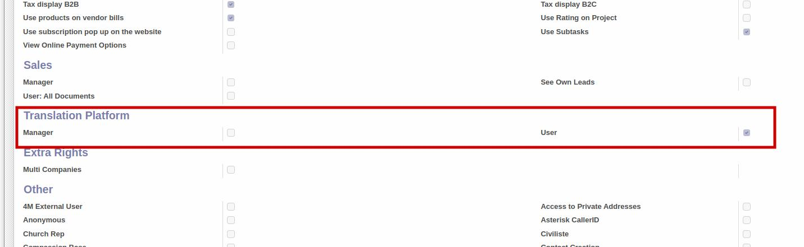

========================
SBC Translation Platform
========================

.. 
   !!!!!!!!!!!!!!!!!!!!!!!!!!!!!!!!!!!!!!!!!!!!!!!!!!!!
   !! This file is generated by oca-gen-addon-readme !!
   !! changes will be overwritten.                   !!
   !!!!!!!!!!!!!!!!!!!!!!!!!!!!!!!!!!!!!!!!!!!!!!!!!!!!
   !! source digest: sha256:8151165b8f2d44964582f6d44fc223fd3b57812a14416f27b9be8334e2d65dd4
   !!!!!!!!!!!!!!!!!!!!!!!!!!!!!!!!!!!!!!!!!!!!!!!!!!!!

.. |badge1| image:: https://img.shields.io/badge/maturity-Beta-yellow.png
    :target: https://odoo-community.org/page/development-status
    :alt: Beta
.. |badge2| image:: https://img.shields.io/badge/licence-AGPL--3-blue.png
    :target: http://www.gnu.org/licenses/agpl-3.0-standalone.html
    :alt: License: AGPL-3
.. |badge3| image:: https://img.shields.io/badge/github-CompassionCH%2Fcompassion--modules-lightgray.png?logo=github
    :target: https://github.com/CompassionCH/compassion-modules/tree/18.0/sbc_translation
    :alt: CompassionCH/compassion-modules

|badge1| |badge2| |badge3|

Compassion SBC Translation Platform
-----------------------------------

This adds the backend management of SBC letters in the translation
stage. Once can manage all letters in translation and keep track of the
progress. It also serves as XMLRPC-API for the Translation Platform
written in OWL
(https://github.com/compassionch/translation-platform-web).

**Table of contents**

.. contents::
   :local:

Installation
============

To install this module, you need to:

1. Clone the translation-platform project
   (https://github.com/compassionch/translation-platform-web).
2. Create a ``.env.production.local`` file and compile the web-app.
3. Copy the compiled app created in the ``dist`` folder into the
   ``/static/tp/`` folder of the module.
4. This will make the front-end interface available from your Odoo
   server with ``http://server_url/translation-platform`` route.

Configuration
=============

To configure this module, you need to:

1. Give access rights to users

   -  Front end translators need the User rights.
   -  Managers need the Manager rights for accessing the backend.

|image1|

2. Leaderboards

   -  Live rankings are computed each time a translator opens the
      leaderboard; they are always up to date and never stored.
   -  The scheduled action "Translation: Update Leaderboards" (every 10
      minutes) only creates the weekly and monthly leaderboards, moves
      leaderboards through their states and freezes the final rankings.
      A leaderboard appears at most 10 minutes after its start.

Usage
=====

To use this module, you need to:

1. Go to /Sponsorship/Correspondence/Translation Platform/ menu

   -  Translation Pool is the list of all letters currently in
      translation
   -  Translators is the list of translators
   -  Competences is the available skills of translations. It is also an
      entry point to the translation pool, filtered by language.

2. Leaderboards (/Translation Platform/Leaderboards, managers only)

   -  Weekly and monthly leaderboards are created automatically by the
      system (Monday 00:00 and first day of the month, Europe/Zurich).
   -  To run a campaign leaderboard, create a campaign badge with a
      start and end date, then create a leaderboard of type Campaign
      linked to it. Its start and end dates are taken from the campaign
      and cannot be edited on the leaderboard: change the campaign dates
      instead. While the leaderboard is scheduled its period follows the
      campaign, and it starts immediately when the campaign dates are
      changed to a period that has already begun.
   -  A leaderboard goes through four states: Scheduled, Live, Results
      being finalized (48 hours after the end) and Final. The final
      ranking is frozen and cannot be modified.
   -  Managers can edit or cancel a scheduled campaign leaderboard. A
      live or closing campaign leaderboard (e.g. created by mistake) can
      also be cancelled: live rankings are not stored, nothing is lost.
      Final leaderboards and running weekly / monthly leaderboards
      cannot be cancelled. Scores and ranks can never be edited
      manually.
   -  Translators can choose to appear as "Anonymous translator" on the
      leaderboards (Leaderboard visibility field on the translator).

Changelog
=========

12.0.1.0.0 (2023-02-28)
-----------------------

-  First version

Bug Tracker
===========

Bugs are tracked on `GitHub Issues <https://github.com/CompassionCH/compassion-modules/issues>`_.
In case of trouble, please check there if your issue has already been reported.
If you spotted it first, help us to smash it by providing a detailed and welcomed
`feedback <https://github.com/CompassionCH/compassion-modules/issues/new?body=module:%20sbc_translation%0Aversion:%2018.0%0A%0A**Steps%20to%20reproduce**%0A-%20...%0A%0A**Current%20behavior**%0A%0A**Expected%20behavior**>`_.

Do not contact contributors directly about support or help with technical issues.

Credits
=======

Authors
-------

* Compassion CH

Contributors
------------

-  Emanuel Cino <ecino@compassion.ch>

Maintainers
-----------

This module is part of the `CompassionCH/compassion-modules <https://github.com/CompassionCH/compassion-modules/tree/18.0/sbc_translation>`_ project on GitHub.

You are welcome to contribute.
