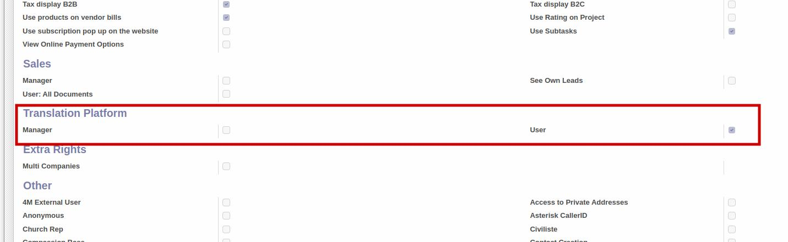

To configure this module, you need to:

1.  Give access rights to users  
    - Front end translators need the User rights.
    - Managers need the Manager rights for accessing the backend.

2.  Leaderboards  
    - Live rankings are computed each time a translator opens the
      leaderboard; they are always up to date and never stored.
    - The scheduled action "Translation: Update Leaderboards" (every 10
      minutes) only creates the weekly and monthly leaderboards, moves
      leaderboards through their states and freezes the final rankings.
      A leaderboard appears at most 10 minutes after its start.
